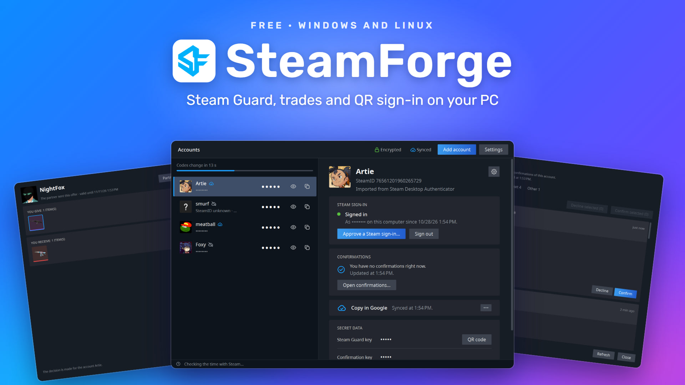
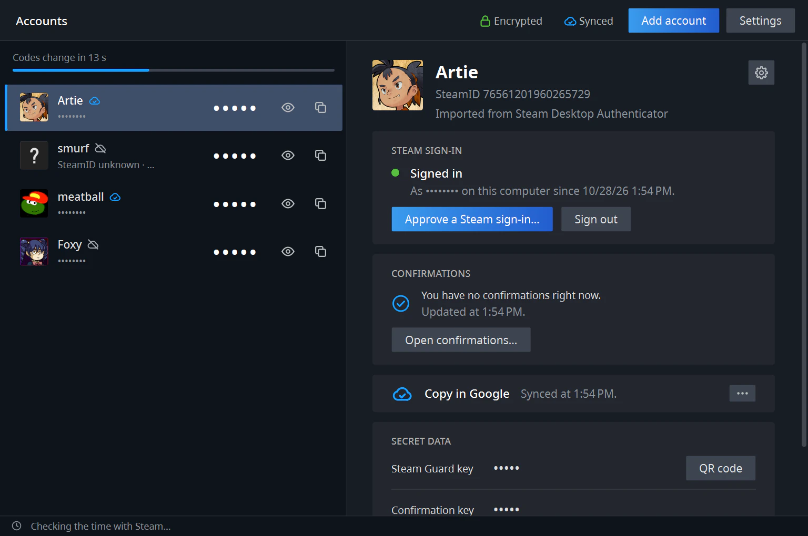
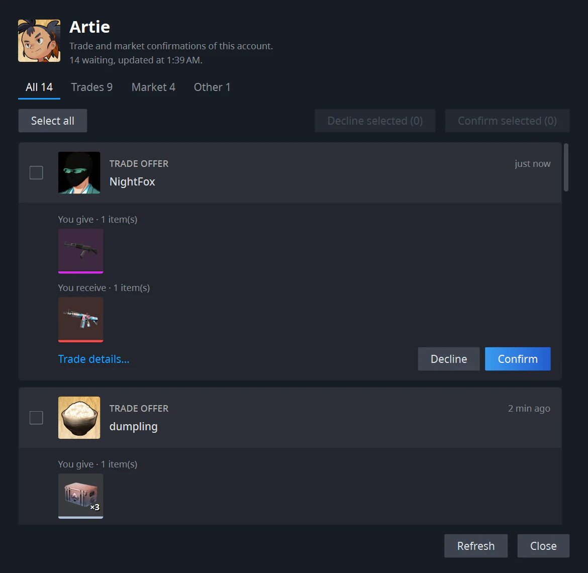
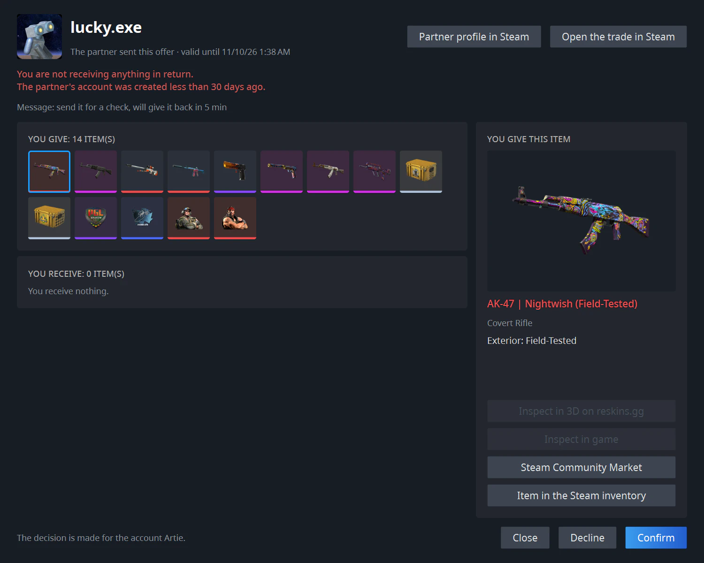
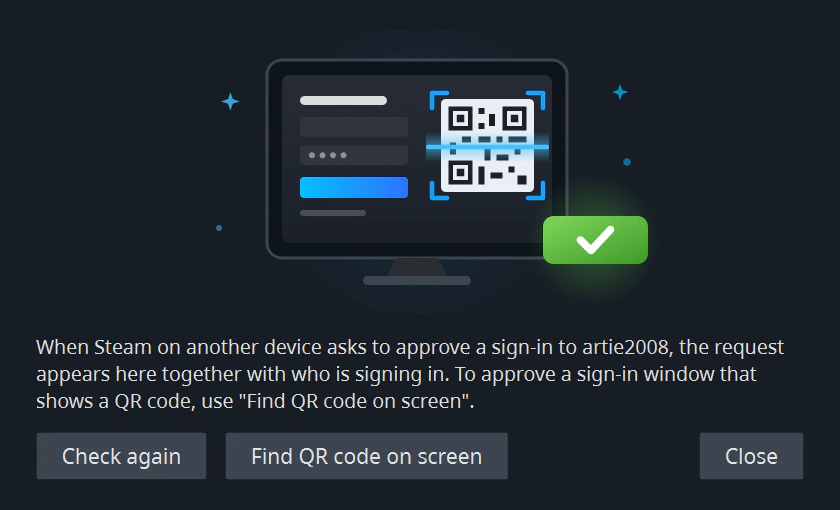
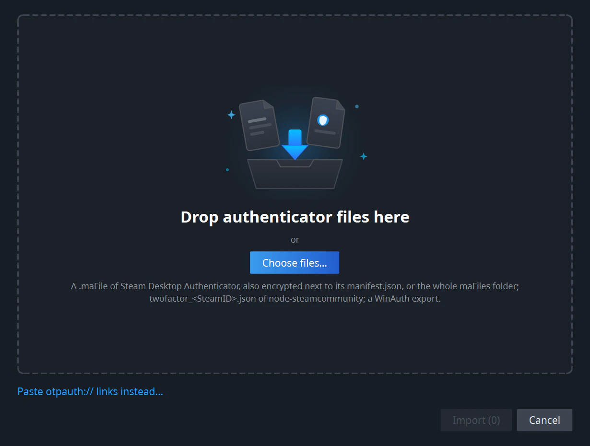
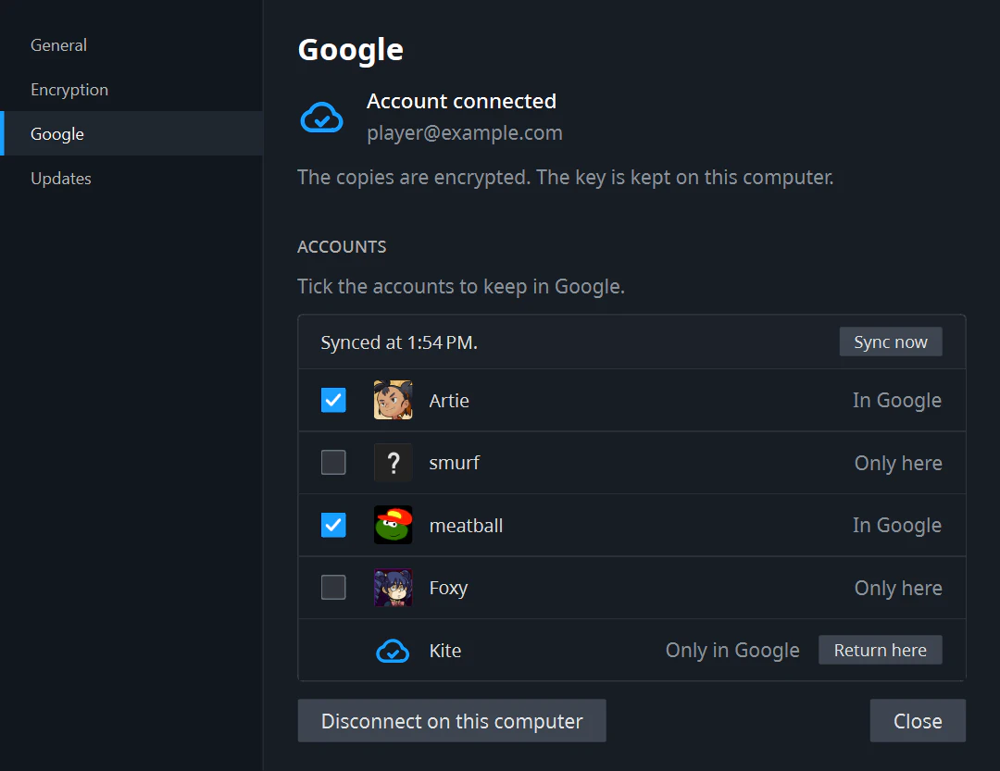
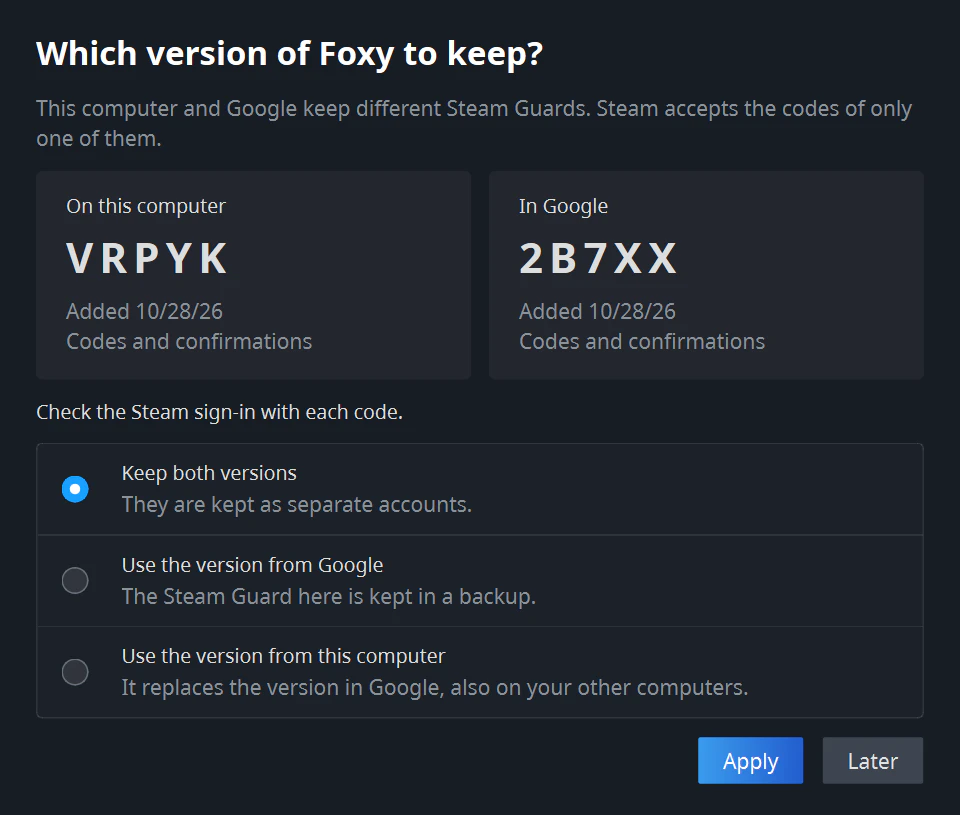
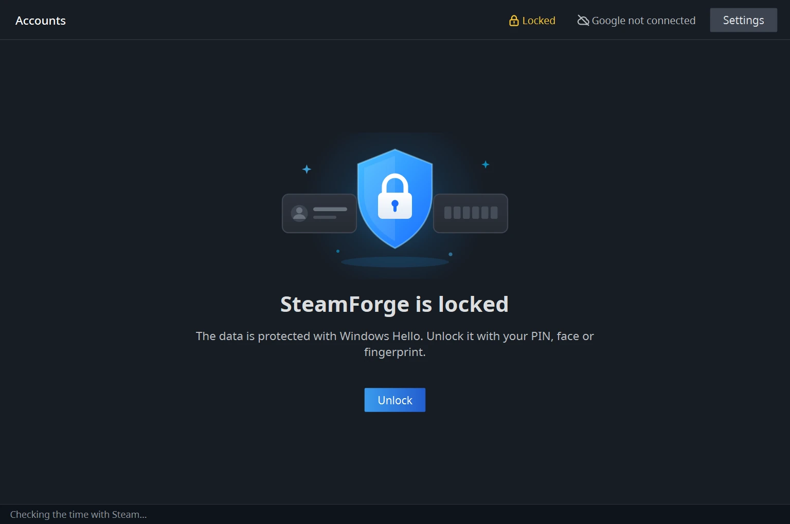

# SteamForge

**Steam Guard on your computer.** Codes, trade confirmations and sign-in approvals for all your Steam accounts in one window, for Windows and Linux. Free and open source.

[Website](https://reskins.gg/steamforge) · [Privacy policy](https://reskins.gg/steamforge/privacy) · [Русская версия](README.ru.md)

## What it does

- **Steam Guard codes** for every account in one list. Codes and account names stay hidden until you click the eye, and the button next to a code copies it.
- **Trade and Market confirmations.** New ones arrive as a notification. You see the items first and then accept or decline. Nothing is ever confirmed without you.
- **Sign-in approval.** When you sign in to Steam on a computer or in a browser, approve it here, or let SteamForge read the QR code shown on your screen.
- **Steam Guard setup** for an account that does not have it yet, and **moving Steam Guard** from the Steam app on your phone to the computer.
- **Import** from Steam Desktop Authenticator (`.maFile`) and WinAuth.
- **Export** of an account to a `.maFile`, or a QR code to add it to another authenticator app.
- **Sync through Google**, if you want it. The accounts you tick are kept encrypted in your Google Drive and appear on your other computers.
- Steam nicknames and avatars, a tray icon, English and Russian.

## How it looks

**All accounts in one window.** Codes and account names stay hidden until you click the eye. The bar at the top shows when the codes change. The top of the window shows whether your data is encrypted and Google is synced, and a cloud next to a nickname shows whether the account is in Google.

**Confirmations.** Trades, Market listings and other actions sit on tabs, and every trade shows its items. Confirm or decline one at a time or several at once.

**Steam warnings in plain sight.** Here is the classic "send it for a check, I'll give it back in 5 minutes" scam: you give 14 items, receive nothing, and the partner's account is less than 30 days old.

**Sign-in approval.** A sign-in to Steam on another device appears here together with who is signing in. If the sign-in window shows a QR code, click **Find QR code on screen**.

## Download

Open [Releases](https://github.com/sazonische/steam-forge/releases) and download one file:

| Your computer | File |
|---|---|
| Windows 10 (version 1809 or newer) or Windows 11, 64-bit | `SteamForge-<version>-windows-x64.exe` |
| Linux, 64-bit: Ubuntu 20.04, Debian 11, Linux Mint 20, Fedora or newer | `SteamForge-<version>-linux-x64` |

There is nothing to install. Put the file in any folder and start it.

**Windows** may say *"Windows protected your PC"*. Click **More info**, then **Run anyway**. The warning appears because the program is not signed with a paid certificate.

**Linux** needs permission to run the file: right-click it, open **Properties** and turn on the option that lets it run as a program.

## Updating

When a new version is out, SteamForge offers it in a window at start. Click **Download** and replace the old file with the new one. Your accounts and settings are kept.

## Getting started

Click **Add account** and pick what fits you:

- **The Steam app on your phone gives your codes.** Choose **Sign in to Steam**, then **Move Steam Guard to SteamForge**. Steam sends a text message to your phone number. From then on SteamForge gives the codes, and the phone app stops.
- **Your account has no Steam Guard codes yet.** Choose **Sign in to Steam**, then **Set up Steam Guard**. Steam sends a code by text message or email.
- **You already use Steam Desktop Authenticator or WinAuth.** Choose **Import from files** and select your `.maFile` files (with `manifest.json` if they are encrypted) or the WinAuth export.

To import, drop the files into the window or click **Choose files…**

Your Steam password is only used to sign in and is never saved.

## Write down your recovery code

When you set up or move Steam Guard, SteamForge shows a **recovery code** like `R12345`. Write it down on paper and keep it safe. It is the only way to remove Steam Guard from your account if you ever lose SteamForge and its files. You can see the code again in the account panel.

## Sync through Google

Google is optional: SteamForge works fully without it. With Google connected, the accounts you tick appear on all your computers with SteamForge.

1. Click **Google not connected** at the top of the window, then **Connect Google…**. Sign in to your Google account in the browser.
2. SteamForge shows a **recovery key** of 32 characters. Write it down. You need it to open the cloud copy on another computer. Without the key, neither Google nor the developers of SteamForge can read it.
3. Tick the accounts you want on your other computers. The others stay only on this one.

On another computer, connect the same Google account and enter the recovery key. The ticked accounts appear by themselves.

- Only Steam Guard data goes to Google, encrypted on your computer before it leaves. Each computer keeps its own Steam sign-in.
- The files are in the hidden app folder of your Google Drive. They do not show in the usual list of files.
- Google needs encryption turned on on the computer, since the key of the cloud copy is kept under it. If encryption is off, SteamForge offers to turn it on.
- If Google already has a **different** Steam Guard of the same account, SteamForge replaces nothing on its own. It shows both versions with their current codes. Steam accepts the codes of only one of them: try signing in and choose the one that works. A key that gets replaced is saved to a backup first.

- **Remove from Google** deletes the cloud copy, and the account stays on your computers. An account removed from one computer stays in Google and on your other computers. Neither turns off Steam Guard on Steam.

## Is it safe?

- Without Google, everything stays on your computer, and SteamForge talks only to Steam. With Google, the accounts you tick go to your Google Drive encrypted. Apart from that, once a day SteamForge asks GitHub whether a new version is out; you can turn this off in **Settings**. In the trade window, an item can be opened in a 3D viewer on reskins.gg, in your browser and only when you click it.
- Nothing happens on its own. Each confirmation and sign-in is approved by you, and every window shows which account it is for.
- The QR code for another app stays blurred until you click **Show QR code**.
- Removing an account from SteamForge does not turn off Steam Guard on Steam.
- The source code is open, and the release files are built automatically on GitHub from it.
- The [privacy policy](https://reskins.gg/steamforge/privacy) lists what SteamForge keeps on your computer and what it sends to Steam, Google and GitHub.

### Encryption

Out of the box, your accounts are stored on the computer **without encryption**, and SteamForge tells you so. To protect them, click **Not encrypted** at the top of the window, then **Turn on encryption**:

- **Windows:** Windows Hello guards the data. SteamForge asks for your PIN, face or fingerprint at every start and before encryption is turned off.
- **Linux:** the key goes to a separate keyring called "SteamForge" with a password you choose. The system asks for this password at every start. In that window, untick **Automatically unlock…**, otherwise it is asked only once.
- Without Windows Hello or a keyring, encryption still works: the key is then tied to your user account, and nothing is asked at start.

Encryption protects copies of your data: backups, cloud folders, a lost or stolen disk. It does not protect against a virus on your computer while SteamForge is open.

Encrypted data opens only on this computer and under your user account. **Before you reinstall the system or move to another computer, export your accounts** (**Manage → Export to .maFile…**) or add them to Google.

Keep exported `.maFile` files and the QR code private. Whoever has them gets your Steam Guard codes.

## Questions

**The codes don't work.** SteamForge sets its clock by Steam's own time, and the line at the bottom of the window shows whether that worked. Check your internet connection.

**Can I keep using the same account on my phone?** If you imported a `.maFile`, every program with that file shows the same codes. Moving Steam Guard from the phone turns the phone app off.

**SteamForge does not start on Linux.** Some systems lack a small library it needs. Install it once: `sudo apt install libxcb-cursor0` on Ubuntu, Debian and Linux Mint, or `sudo dnf install xcb-util-cursor` on Fedora.

**Where are my files?** On Windows in `%APPDATA%\SteamForge`, on Linux in `~/.local/share/SteamForge`. To keep everything next to the program, for example on a USB stick, put an empty file named `.portable` beside it. The data then goes to the `SteamForgeData` folder.

**I lost the Google recovery key.** Connected computers do not ask for it and keep working. If you need the key for a new computer, click **No key? Make a new cloud copy…** there. The old cloud copy is deleted, the accounts on the computer stay, and you can add them to the new copy right away. Your other computers then need to be connected again, with the new key.

## Coming later

- Removing Steam Guard with the recovery code and adding a phone number.
- Inventories and sending trade offers.

## License

[MIT](LICENSE). SteamForge is not affiliated with Valve or Steam.
