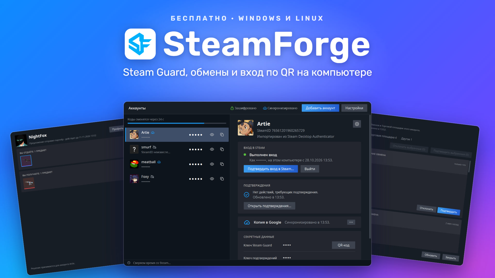
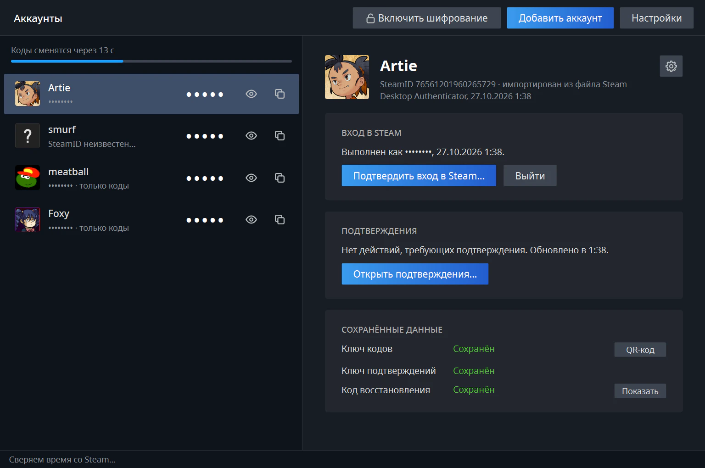
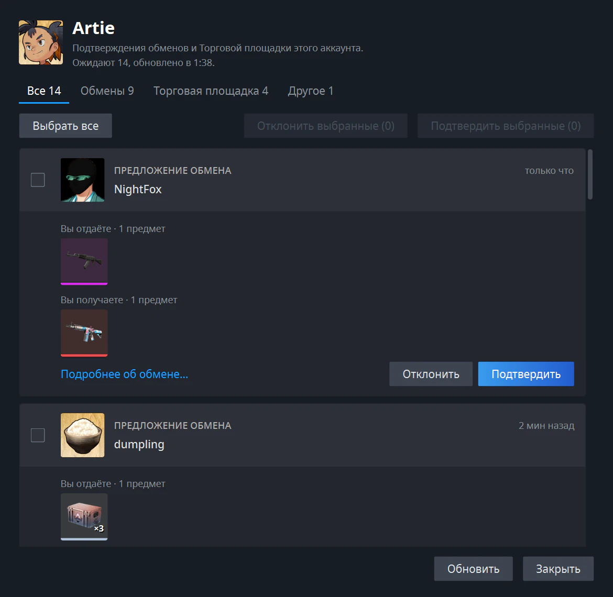
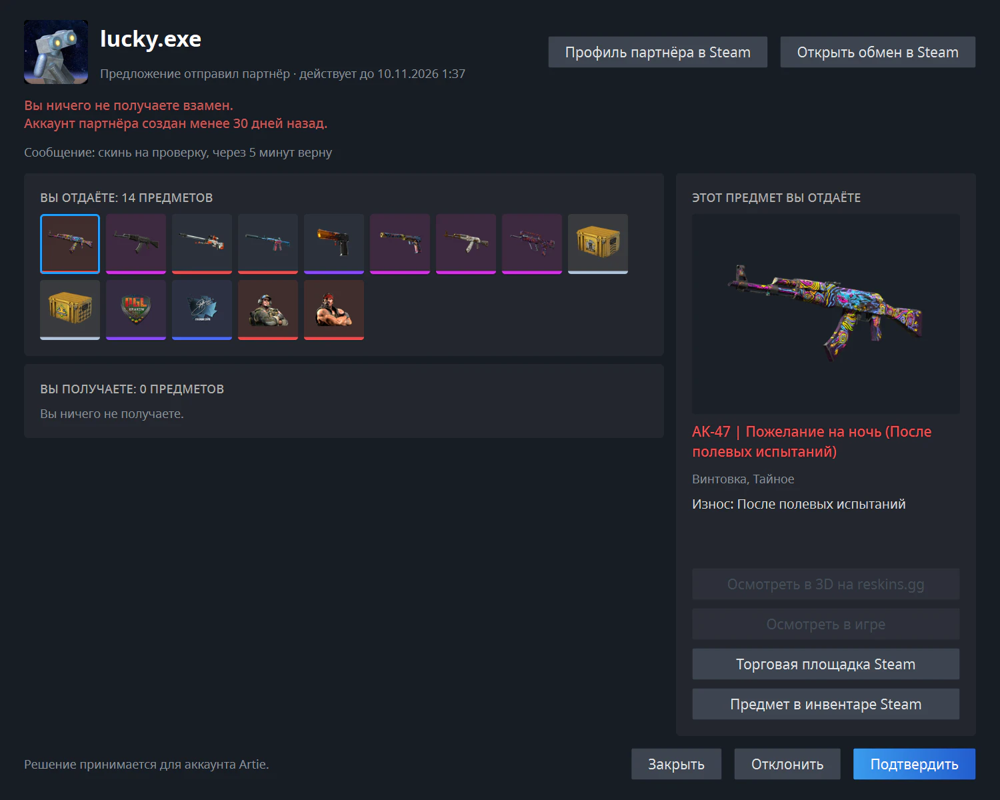
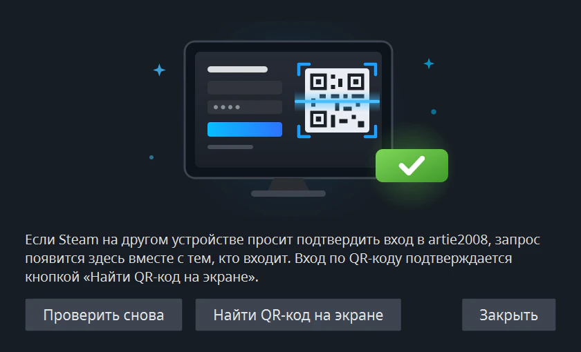
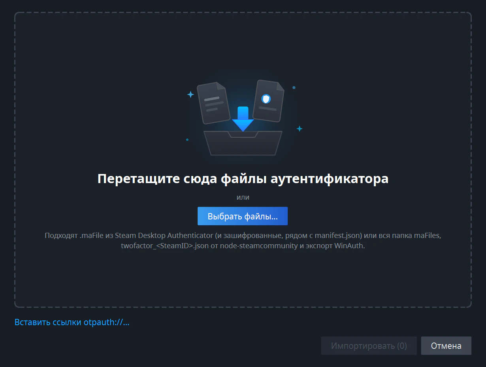
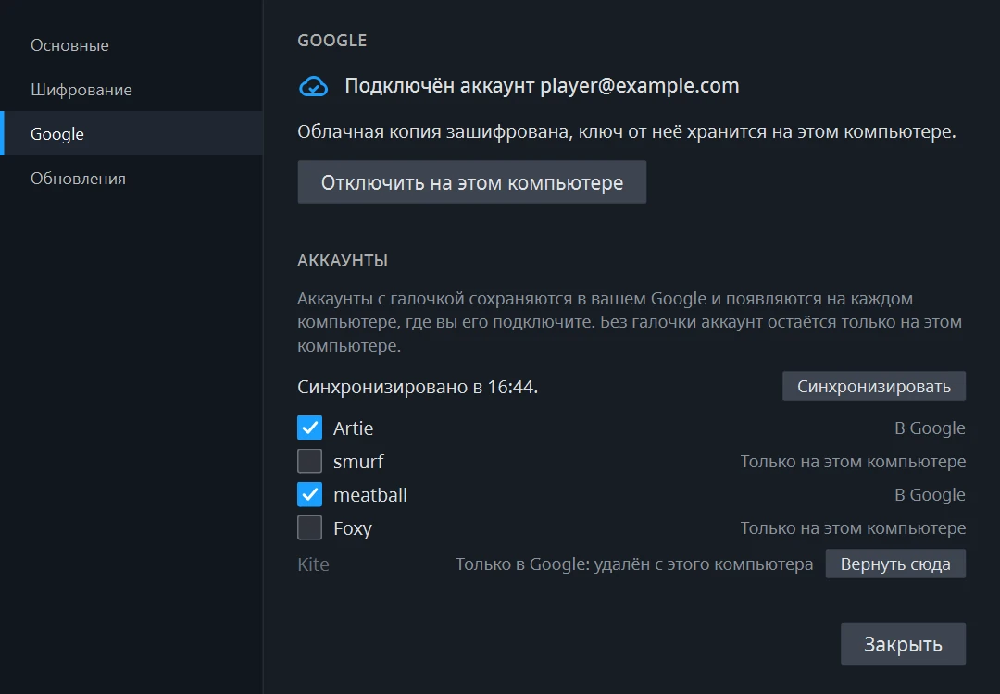
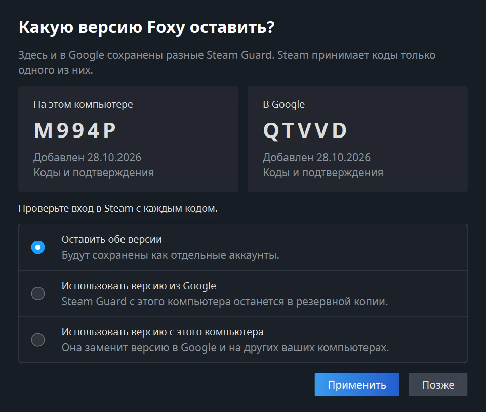
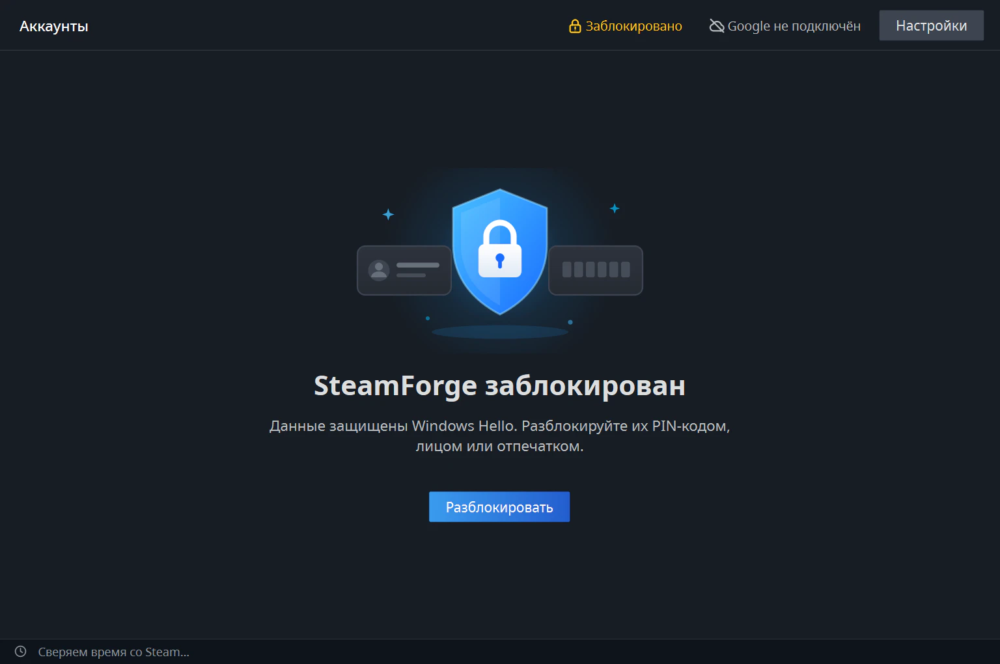

# SteamForge

**Steam Guard на вашем компьютере.** Коды, подтверждения обменов и входов для всех ваших аккаунтов Steam в одном окне, для Windows и Linux. Бесплатно и с открытым кодом.

[Сайт](https://reskins.gg/ru/steamforge) · [Политика конфиденциальности](https://reskins.gg/ru/steamforge/privacy) · [English version](README.md)

## Что умеет

- **Коды Steam Guard** для всех аккаунтов одним списком. Коды и логины скрыты, пока вы не нажмёте на глаз, а кнопка рядом с кодом копирует его.
- **Подтверждения обменов и Торговой площадки.** О новых приходит уведомление. Вы сначала видите предметы, а потом принимаете или отклоняете. Без вас ничего не подтверждается.
- **Подтверждение входа.** Когда вы входите в Steam на компьютере или в браузере, подтвердите вход здесь или дайте SteamForge прочитать QR-код с экрана.
- **Подключение Steam Guard** для аккаунта, где его ещё нет, и **перенос Steam Guard** из приложения Steam на телефоне на компьютер.
- **Импорт** из Steam Desktop Authenticator (`.maFile`) и WinAuth.
- **Экспорт** аккаунта в `.maFile` или QR-код, чтобы добавить его в другое приложение-аутентификатор.
- **Синхронизация через Google**, если хотите. Отмеченные аккаунты хранятся в вашем Google Диске в зашифрованном виде и появляются на других ваших компьютерах.
- Ники и аватары из Steam, значок в трее, русский и английский язык.

## Как это выглядит

**Все аккаунты в одном окне.** Коды и логины скрыты, пока вы не нажмёте на глаз. Полоска сверху показывает, когда сменятся коды. Вверху видно, зашифрованы ли данные и синхронизирован ли Google, а облачко рядом с ником показывает, есть ли аккаунт в Google.

**Подтверждения.** Обмены, Торговая площадка и прочие действия разложены по вкладкам, у каждого обмена видны предметы. Подтвердить или отклонить можно по одному или сразу несколько.

**Предупреждения Steam на виду.** На кадре классический развод «скинь на проверку, через 5 минут верну»: вы отдаёте 14 предметов, ничего не получаете, а аккаунту партнёра меньше 30 дней.

**Подтверждение входа.** Вход в Steam на другом устройстве появляется здесь вместе с тем, кто входит. Если окно входа показывает QR-код, нажмите **Найти QR-код на экране**.

## Скачать

Откройте [Releases](https://github.com/sazonische/steam-forge/releases) и скачайте один файл:

| Ваш компьютер | Файл |
|---|---|
| Windows 10 (версия 1809 или новее) или Windows 11, 64-битная | `SteamForge-<версия>-windows-x64.exe` |
| Linux, 64-битный: Ubuntu 20.04, Debian 11, Linux Mint 20, Fedora или новее | `SteamForge-<версия>-linux-x64` |

Устанавливать ничего не нужно. Положите файл в любую папку и запустите.

**Windows** может написать *«Система Windows защитила ваш компьютер»*. Нажмите **Подробнее**, затем **Выполнить в любом случае**. Предупреждение появляется, потому что программа не подписана платным сертификатом.

**Linux** должен разрешить запуск файла: нажмите на него правой кнопкой, откройте **Свойства** и включите запуск файла как программы.

## Обновление

Когда выйдет новая версия, SteamForge предложит её в окне при запуске. Нажмите **Скачать** и замените старый файл новым. Аккаунты и настройки сохранятся.

## С чего начать

Нажмите **Добавить аккаунт** и выберите свой случай:

- **Коды даёт приложение Steam на телефоне.** Выберите **Войти в Steam**, затем **Перенести Steam Guard в SteamForge**. Steam пришлёт SMS на номер телефона аккаунта. После этого коды будет давать SteamForge, а приложение на телефоне перестанет.
- **У аккаунта ещё нет кодов Steam Guard.** Выберите **Войти в Steam**, затем **Подключить Steam Guard**. Steam пришлёт код в SMS или на почту.
- **Вы уже пользуетесь Steam Desktop Authenticator или WinAuth.** Выберите **Импортировать из файлов** и укажите свои файлы `.maFile` (вместе с `manifest.json`, если они зашифрованы) или экспорт WinAuth.

Чтобы импортировать, перетащите файлы в окно или нажмите **Выбрать файлы…**

Пароль от Steam нужен только для входа и нигде не сохраняется.

## Запишите код восстановления

Когда вы подключаете или переносите Steam Guard, SteamForge показывает **код восстановления** вида `R12345`. Запишите его на бумагу и храните в надёжном месте. Только с ним можно снять Steam Guard с аккаунта, если вы потеряете SteamForge вместе с его файлами. Код можно посмотреть ещё раз в панели аккаунта.

## Синхронизация через Google

Google не обязателен, SteamForge полностью работает и без него. Если подключить Google, отмеченные аккаунты появятся на всех ваших компьютерах с SteamForge.

1. Нажмите **Google не подключён** вверху окна, затем **Подключить Google…**. Войдите в свой аккаунт Google в браузере.
2. SteamForge покажет **ключ восстановления** из 32 знаков. Запишите его. Ключ нужен, чтобы открыть облачную копию на другом компьютере. Без ключа её не прочитает ни Google, ни разработчики SteamForge.
3. Отметьте аккаунты, которые нужны на других компьютерах. Остальные останутся только на этом.

На другом компьютере подключите тот же Google и введите ключ восстановления. Отмеченные аккаунты появятся сами.

- В Google уходят только данные Steam Guard, зашифрованные ещё на вашем компьютере. Вход в Steam на каждом компьютере свой.
- Файлы лежат в скрытой папке приложения на вашем Google Диске. В обычном списке файлов их не видно.
- Для Google на компьютере должно быть включено шифрование: под ним хранится ключ облачной копии. Если шифрование выключено, SteamForge предложит его включить.
- Если в Google уже есть **другой** Steam Guard того же аккаунта, SteamForge ничего не заменяет сам, а показывает обе версии с текущими кодами. Steam принимает коды только одной из них: попробуйте войти и выберите ту, что подходит. Заменяемый ключ сначала сохраняется в резервную копию.

- **Убрать из Google** удаляет облачную копию, а аккаунт остаётся на ваших компьютерах. Аккаунт, удалённый с одного компьютера, остаётся в Google и на других компьютерах. Ни то ни другое не отключает Steam Guard в самом Steam.

## Это безопасно?

- Без Google всё хранится только на вашем компьютере, и SteamForge общается только со Steam. С Google отмеченные аккаунты уходят в ваш Google Диск зашифрованными. Кроме этого, раз в сутки SteamForge спрашивает у GitHub, не вышла ли новая версия; это можно выключить в **Настройках**. В окне обмена предмет можно открыть в 3D на reskins.gg: это откроется в вашем браузере и только по нажатию.
- Ничего не происходит само. Каждое подтверждение и каждый вход подтверждаете вы, и в каждом окне видно, для какого аккаунта действие.
- QR-код для другого приложения размыт, пока вы не нажмёте **Показать QR-код**.
- Удаление аккаунта из SteamForge не отключает Steam Guard в самом Steam.
- Исходный код открыт, а файлы для скачивания собираются из него автоматически на GitHub.
- В [политике конфиденциальности](https://reskins.gg/ru/steamforge/privacy) перечислено, что SteamForge хранит на компьютере и что отправляет в Steam, Google и GitHub.

### Шифрование

Сразу после установки аккаунты хранятся на компьютере **без шифрования**, и SteamForge прямо об этом пишет. Чтобы защитить их, нажмите **Без шифрования** вверху окна, затем **Включить шифрование**:

- **Windows:** данные охраняет Windows Hello. SteamForge спрашивает PIN-код, лицо или отпечаток при каждом запуске и перед выключением шифрования.
- **Linux:** ключ хранится в отдельной связке ключей «SteamForge» с паролем, который вы придумаете. Система спрашивает этот пароль при каждом запуске. В этом окне снимите галочку **Автоматически разблокировать…**, иначе пароль спросят только один раз.
- Без Windows Hello или связки ключей шифрование тоже работает: тогда ключ привязан к вашей учётной записи, и при запуске ничего не спрашивается.

Шифрование защищает копии ваших данных: резервные копии, облачные папки, потерянный или украденный диск. От вируса на компьютере, пока SteamForge открыт, оно не защищает.

Зашифрованные данные открываются только на этом компьютере и под вашей учётной записью. **Перед переустановкой системы или переходом на другой компьютер сделайте экспорт** (**Управление → Экспортировать в .maFile…**) или добавьте аккаунты в Google.

Никому не показывайте экспортированные файлы `.maFile` и QR-код. У кого они есть, тот получает ваши коды Steam Guard.

## Вопросы

**Коды не подходят.** SteamForge сверяет часы с временем Steam, а строка внизу окна показывает, получилось ли. Проверьте подключение к интернету.

**Можно пользоваться аккаунтом и на телефоне?** Если вы импортировали `.maFile`, то все программы с этим файлом показывают одинаковые коды. Перенос Steam Guard с телефона отключает приложение на телефоне.

**SteamForge не запускается на Linux.** В некоторых системах нет маленькой библиотеки, которая ему нужна. Установите её один раз: `sudo apt install libxcb-cursor0` в Ubuntu, Debian и Linux Mint или `sudo dnf install xcb-util-cursor` в Fedora.

**Где мои файлы?** В Windows в папке `%APPDATA%\SteamForge`, в Linux в `~/.local/share/SteamForge`. Чтобы всё лежало рядом с программой, например на флешке, положите рядом с ней пустой файл с именем `.portable`. Тогда данные будут в папке `SteamForgeData`.

**Я потерял ключ восстановления Google.** Подключённые компьютеры ключ не спрашивают и работают как раньше. Если ключ нужен для нового компьютера, нажмите там **Нет ключа? Создать новую облачную копию…**. Старая облачная копия удалится, аккаунты на компьютере останутся, и их можно сразу добавить в новую копию. Остальные компьютеры после этого нужно подключить заново, уже с новым ключом.

## Скоро

- Снятие Steam Guard кодом восстановления и привязка номера телефона.
- Инвентари и отправка обменов.

## Лицензия

[MIT](LICENSE). SteamForge не связан с Valve и Steam.
